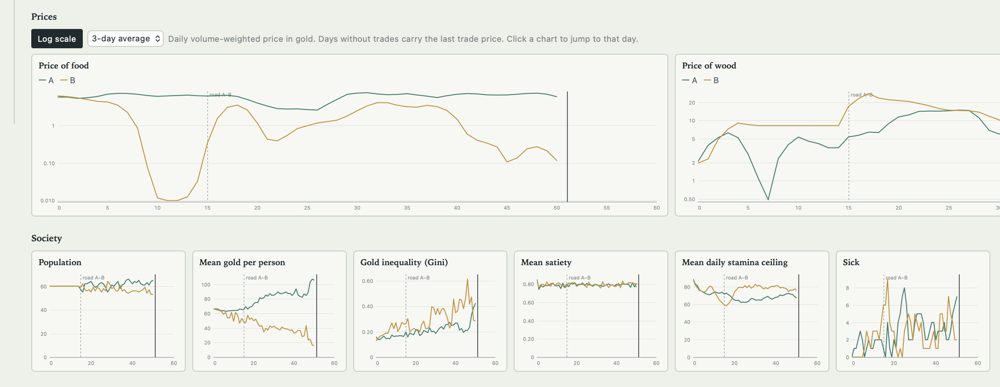
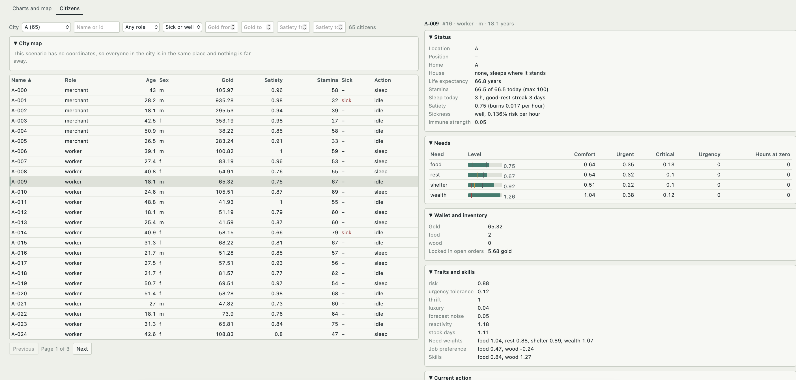
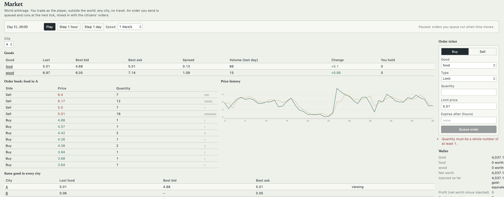
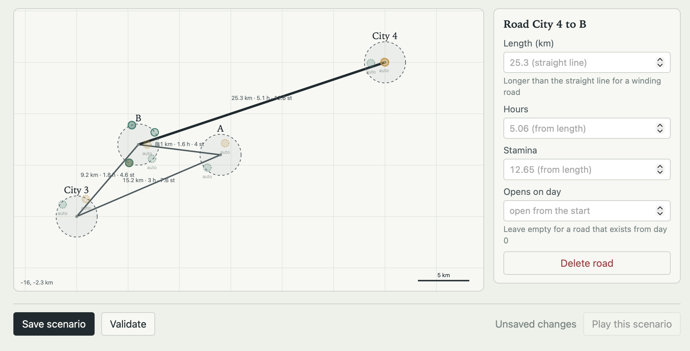

# popsim

popsim is an agent-based society simulation, written in pure Python on a custom Entity-Component-System, where prices, inflation and trade flows emerge from NPCs with needs, traits and local information trading through per-city order books. Gold and goods are strictly conserved, so every economic effect can be traced to its cause. You run scenarios, watch them in a web dashboard, and even trade by hand as a player. It can be used as a standalone application for world building or in parallel with some game to mod it with a simulated economy.



## Features

- **Emergent economy:** no scripted prices; NPCs with needs (food, rest, shelter, wealth), traits and remembered prices decide, work, trade and travel.

  

- **Order-book markets:** a continuous double auction per city, with merchants that scout roads and arbitrage price gaps.

  

- **Strict conservation:** gold and goods are audited every day and by a full ledger replay at the end of each run.
- **Scenarios in YAML:** cities, resources, roads, taxes, public jobs and events (stimulus, minting, new roads), with inheritance between files.
- **Spatial worlds:** coordinates, houses, workplaces and walking time between places.

  

- **Web dashboard:** run viewer with map, scrubber and charts; citizen inspector; run comparison; scenario editor with a map editor; live play with pause, step and speed control.
- **Player market:** trade by hand on a live world, with reproducible replays.
- **Market REST API:** the market can run in-process or as a separate service backed by SQLite.
- **Reproducible:** same scenario and seed give the same run, and the test suite checks it.

## Setup

Only Docker (with Compose) and `make` are needed. Nothing is installed on the host.

```bash
make build    # build the images
make start    # start the market API and the dashboard
```

Then open <http://localhost:8000>. Use `make stop` to stop and `make clean` to also remove images and data.

## License

[PolyForm Noncommercial 1.0.0](LICENSE): free to use, modify and share for any noncommercial purpose.
Commercial use needs prior authorization from the author; open an issue or contact the repository owner to ask.
This is a source-available license, not an OSI open-source one.

Specification: [INSTRUCTIONS.md](INSTRUCTIONS.md) and [SPECIFICATIONS.md](SPECIFICATIONS.md). Build plan and status: [MVP_PLAN.md](MVP_PLAN.md).

## Dashboard

Start it with `make start` (see Setup) and open <http://localhost:8000>.

- **Runs:** every folder in `runs/`. A run opens on a world map with a day scrubber (drag it, or press
  Replay) beside the city figures for that day. Below are interactive charts of prices, society and
  trade (log/linear, smoothing, hover values; click a chart to jump to that day), plus tables of
  events, deaths and conservation checks.
- **Citizens (inspector):** the *Citizens* tab of a live run, and of a saved run that has a snapshot
  (`end.pkl`), lists every citizen of a city (sort, filter, search, paging). Click one to see status,
  needs, wallet, traits, current action and why, open orders, spending plan, purchase and sales
  history with a daily spent/earned chart, action history, jobs and remembered prices. It follows the
  citizen if they travel, and keeps dead citizens for `inspector.dead_keep_days`. Histories are kept
  per NPC in bounded buffers (`inspector.buffer`, default 500 entries); set `inspector.record: false`
  to turn them off. Recording never changes results.
- **Market:** trade by hand on the live world, as a player outside the world (any city, no travel).
  Open the account (a grant of gold from the central authority: by default half of the gold the
  citizens started with; set `player: {gold_share | gold, goods}` in a scenario), then use the order
  ticket. Orders are *scheduled*: a limit or market order is queued with its funds locked, and runs at
  the next tick, mixed in with the citizens' orders by the same seeded shuffle; cancelling an order that
  already rests on the book also runs at the next tick. *Top up* adds gold or goods at any time. It is
  counted as an injection, and profit is always shown net of what you injected. The tab also shows the
  books, a price chart, the same good in every city, your wallet, open orders, history and net worth.
  A saved run keeps `player_trades.csv` and `player_actions.json`; replaying the same scenario, seed and
  actions gives the same run. A saved run with a snapshot can be continued from the Market tab.
- **Compare:** overlay prices or society series from several runs, for example `inflation` against
  `inflation_control`.
- **Scenarios:** edit cities, resources, roads and events in a form, on a map, or anything else in the YAML
  tab. The three stay in sync. On the **Map** tab, pick a tool and click: *City* places a city (drag it to move,
  drag the handle on its edge to resize), *Road* drags from one city to another, *Resource*, *Workplace* and
  *House* click inside a city, and *Scatter* drags a circle to fill an area with items. Items left without a
  position are placed by the simulation and shown faded, at exactly the spot it will use. The helpers
  (arrange cities, connect cities, fill in resources, workplaces and houses, remove positions) show what they
  would add and apply as one step. Undo and redo, arrow keys, Delete and Esc work; problems are outlined on the
  map and listed below it; a draft is kept in the browser if the page is closed. Validation runs as you type, and saving writes `scenarios/<name>.yaml`.
- **Play:** start a live run of any scenario, then play, pause, step an hour or a day, and change the
  speed while the map and charts update. Save writes a normal run folder. One live run at a time;
  a saved live run is identical to `popsim run` with the same scenario and seed.

To place cities on the map yourself, give them a `pos: [x, y]` (each 0–1). The simulation ignores it.

## Containers (Docker Compose)

Everything runs in containers, with no host Python needed (REQ-1B.2, REQ-1B.3). The images
install dependencies from the committed `uv.lock`.

```bash
docker compose up --build -d                             # API + dashboard on :8000
docker compose run --rm sim run scenarios/inflation.yaml --out runs/inflation
docker compose run --rm sim compare runs/baseline runs/arbitrage --out runs/compare.png
docker compose --profile test run --rm test              # test suite in a container
docker compose down                                      # API snapshots stay in the api-data volume
```

| service | image target | what it does |
|---|---|---|
| `api` | `api` | market REST API on port 8080, SQLite on the `api-data` volume, healthcheck on `/health` |
| `dashboard` | `sim` | web dashboard on port 8000; reads `./runs`, reads and writes `./scenarios`; live runs use `api` |
| `sim` | `sim` | `popsim` command line for one-off runs (profile `batch`, started by `docker compose run`) |
| `test` | `test` | `pytest -q` with the dev dependency group (profile `test`) |

Environment variables (REQ-1B.4, REQ-1C.1):
- `POPSIM_API_URL`: the market API the simulation uses. Unset means the in-process market;
  `--local` forces in-process.
- `POPSIM_DB` and `POPSIM_PORT`: the API's SQLite path and port.
- `POPSIM_DASHBOARD_PORT`, `POPSIM_RUNS_DIR` and `POPSIM_SCENARIOS_DIR`: the dashboard's port and folders.
- `POPSIM_HOST_PORT` and `POPSIM_DASHBOARD_HOST_PORT`: the host ports compose publishes (default 8080 and 8000).

Images run as a non-root user. On Linux hosts, if `./runs` or `./scenarios` is not writable by the
container, make it writable for the container user.

## Scenarios

| file | what happens |
|---|---|
| `baseline.yaml` | Two isolated cities. A is forested (cheap wood), B is a desert (scarce wood). |
| `arbitrage.yaml` | Baseline plus a road A–B on day 15. Merchants scout, then ship wood A→B (and cheap food B→A). B's wood price falls and A's rises. |
| `inflation.yaml` | 50% of gold starts in treasuries. Stimulus of 60 gold per NPC on day 20. Prices in A roughly double. |
| `inflation_control.yaml` | Same economy, no stimulus: the counterfactual. |

| `taxes.yaml` | Income and sales tax, public jobs paid by the city treasury, a daily support payment; city B taxes at its own rate. |
| `spatial.yaml` | Cities with coordinates, houses and nodes at positions. People walk to work and home; the road A–B is derived from the distance. |
| `overworld.yaml` | Resource points outside the cities on branch roads, and houses generated from a percentage of the population (120% in one city, 80% in the other). |

Scenario files `extends:` another file (or `default`) and override any key. Events: `stimulus`,
`mint` (the only way to create gold), `add_road`/`set_road`, `remove_road`, timed by `day` (+`hour`) or `tick`.

### Taxes and public spending

Policy is fixed per scenario (`fiscal:` in the config; a city's own `fiscal:` overrides it) and everything
defaults to zero. Each city collects and spends from its own treasury, which starts with `money.treasury_share`
of all gold:

- `income_tax`: a share of wages and of sales proceeds, to the city where the money was earned.
- `sales_tax`: a share of each transaction's value, paid by the buyer (as far as the buyer can afford it).
- `workplaces` (per city: `task`, `wage` per hour, `slots`, `stamina_per_hour`, optional `at`): public jobs.
  Citizens weigh them against gathering like any job (wage after tax per stamina, the walk counted both ways).
  The treasury pays each hour worked; with an empty treasury the job closes. Public work produces nothing
  physical, it is paid effort (guard duty, road crews).
- `support: {amount, hour}`: once a day each resident whose food, rest or shelter is at or below its urgent
  level gets up to `amount` gold; if the treasury cannot pay everyone, it is shared.

All of it moves gold through the ledger, so the money supply stays fixed. `cities_daily.csv` gains
`tax_collected`, `wages_paid` and `support_paid`; the run view adds treasury and finance charts, and the inspector
shows a citizen's job, wage, taxes paid and support received.

### Positions and movement

Give every city `x`, `y` (km) and a `radius` and the world becomes spatial (all cities or none).
Nodes, `houses` (a list, or `{count: N}`) and `workplaces` take `at: [dx, dy]`, an offset from the city
centre; leave it out and the position is generated, reproducibly, inside the city.

- A road's `length` defaults to the straight-line distance; `hours` and `stamina_cost` default to
  `length / movement.road.speed` and `length * movement.road.stamina_per_unit`. Give any of them to override.
- Citizens walk inside a city (`movement.walk`). A job at another position means walk there, then work. Its
  income per stamina counts the walk both ways; its income per hour counts only the hours at the job.
- A citizen with a house walks home to sleep when the extra rest (`movement.home_rest_multiplier`) is worth the
  walk; anyone else sleeps where they stand at the base rate.
- Scenarios without coordinates behave exactly as before (everything sits at one point). The run output gains
  `world.json` (positions, derived road values), `roads.csv`, and `walk_hours` / `walk_stamina` in `cities_daily.csv`.
- Workplaces are public jobs: citizens walk to them and work for a wage (see above).

## Market API (REST)

The API starts with `make start` (port 8080). The `sim` service already uses it through `POPSIM_API_URL`:

```bash
docker compose run --rm sim run scenarios/arbitrage.yaml --save runs/a.pkl
docker compose run --rm sim run --resume runs/a.pkl --days 10
```

| route | purpose |
|---|---|
| `POST /{world}/{city}/orders/batch` | `{"tick", "orders": [{"op":"place",owner,side,good,qty,price} \| {"op":"cancel",order_id,owner}]}`. Returns one result per order (partial success), plus fills, prices, volume and top of book. |
| `GET /{world}/{city}/prices` · `/book/{good}` · `/orders?owner=` · `/locked` | city-local reads |
| `GET/PUT /{world}/state` · `DELETE /{world}` | whole-world market state |
| `GET/POST /{world}/snapshots` · `POST /{world}/snapshots/{name}/restore` | SQLite snapshots |

Live state is kept in memory and written to SQLite only when the simulation saves a snapshot.
On restart the API loads each world's latest snapshot; anything changed since the last save is lost
(REQ-1A.6). The server uses only the standard library, so the `api` image installs no packages.

By default the simulation uses an in-process copy of the same `MarketService`. The tests check that
the in-process and HTTP runs produce identical results.

## Layout

```
src/popsim/
  ecs.py                 World: entity IDs, dict-per-component stores, sorted queries
  components/            pure dataclasses (Stamina, Needs, Traits, Yield, Road, MerchantState, ...)
  ledger/                the one transfer API for gold and goods; escrow accounts; log replay
  market/                orderbook (CDA), service, SQLite store, local + HTTP clients, REST server
  systems/               events, regeneration, physiology, needs, consumption, decision,
                         merchant, action, market, aging, metrics; agent.py = shared reasoning
  world/                 Simulation (clock, pipeline, travel, death), builder, seeded sampling
  config/default.yaml    every number lives here (needs table, traits, pricing, merchants)
  io/                    metrics, CSV/JSON output, matplotlib plots, paired snapshots
  dashboard/             web dashboard: server, live sessions, static single-page app
scenarios/               YAML scenarios
tests/                   pytest: ECS/ledger, market, biology, simulation, API, dashboard, acceptance
```

## How the economy works

- **Tick:** 1 hour. The order of systems comes from `pipeline` in the config and runs:
  events → regeneration → physiology → needs → consumption → decision → action → market → aging → metrics.
- **Needs:** food, rest, shelter and wealth, each a 0–1 level. Every NPC has its own comfort,
  urgent and critical thresholds. Urgency is 0 above comfort, 1 at critical, and rises steeply below
  critical. At critical the order is strict (starving beats everything); below it, needs are weighed
  by per-NPC traits.
- **Shelter:** an MVP stand-in for housing. It decays over time and is refilled by using wood, which
  gives every city a steady demand for wood. While shelter is critical, sleep restores less stamina
  and sickness is more likely.
- **Decisions:** each NPC commits to an action (sleep, a 4-hour work shift, travel) and finishes it
  unless something urgent interrupts. Buying, selling and eating are instant side actions.
- **Work:** NPCs pick a job mainly by expected income per unit of stamina, with smaller weights for
  preference and skill. The urge to work fades as savings approach the NPC's target, and work only
  appeals if it pays close to the NPC's reservation wage. When the market fails to supply a need
  good, the NPC gathers it itself.
- **Prices:** each NPC keeps an EMA (moving average) of prices it has seen, per city and good, and
  ignores cities it has never visited. Bids rise with urgency, wealth and repeated unfilled orders,
  but are capped at a share of the NPC's gold. Asks rise with wealth and fall with desperation and
  repeated unsold orders. On ticks with no trades, unmet bids or asks on the board still pull
  expectations toward the book.
- **Merchants:** they compare a remembered price elsewhere with the local price minus the trip
  cost. If the margin is big enough they buy, travel, sell, and repeat. On a newly opened road they
  first scout it.
- **Conservation:** all gold is minted at genesis by `authority`, and all goods come from `nature`
  (regeneration) and go back to it (consumption). Every asset sums to zero across all accounts.
  Every day the run checks that totals still sum to zero and that goods changed by exactly
  regeneration minus consumption. At the end it replays the whole ledger log, and checks that each
  city's escrow equals what the market reports as locked.

## Known limitations

- B's food market swings and sometimes hits the 1-cent price floor, because desert NPCs over-produce
  food while short of wood.
- Wood's stamina per unit by skill in `summary.json` mixes both cities, whose wood nodes differ in
  cost.
- Out of scope for the MVP: medicine, luxury and tools; housing, contracts and debt; taxes and public
  spending; births; multi-day planning; an employer job board; parallel systems.
